# A7 – FEA

## Objective

-Use Finite Element Analysis (FEA) to improve the bracket design from previous assignments.  
-Ensure high stiffness, strength, and lightweight optimization through iterative design.  
-Conduct multiple FEA simulations, refining geometry based on results.  
-Perform static stress analysis, including constraints, loading, and meshing selection.  
-Interpret data by identifying max stress, displacement, and safety factors.  
-Optimize the design by modifying geometry to enhance performance.  

## FEA on Bracket  

I begun my use of FEA by analyzing my previously made bracket without any edits to test it's safety factor, max stress and max deflection.  

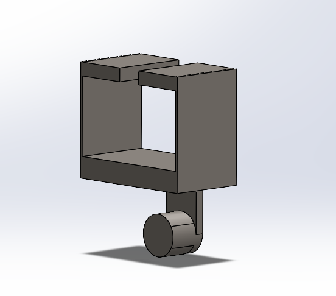  

I then constrained the bracket where the t-beam would make contact with the bracket, and used the split line tool in SolidWorks to isolate an area on the cylinder where the force would be applied.  

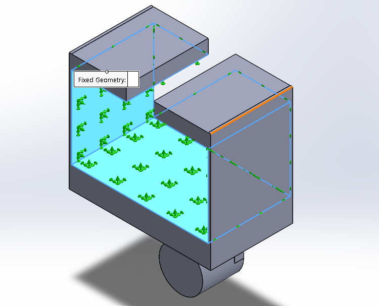 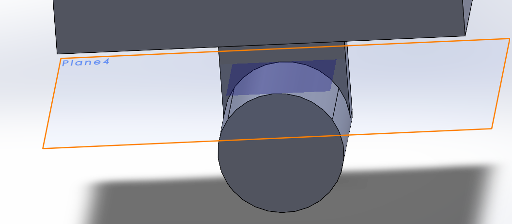 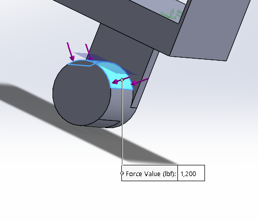  

A study was conducted three times on the bracket because the first and second did not yield results that converged. However, the third test with a fine mesh did converge with the first.  

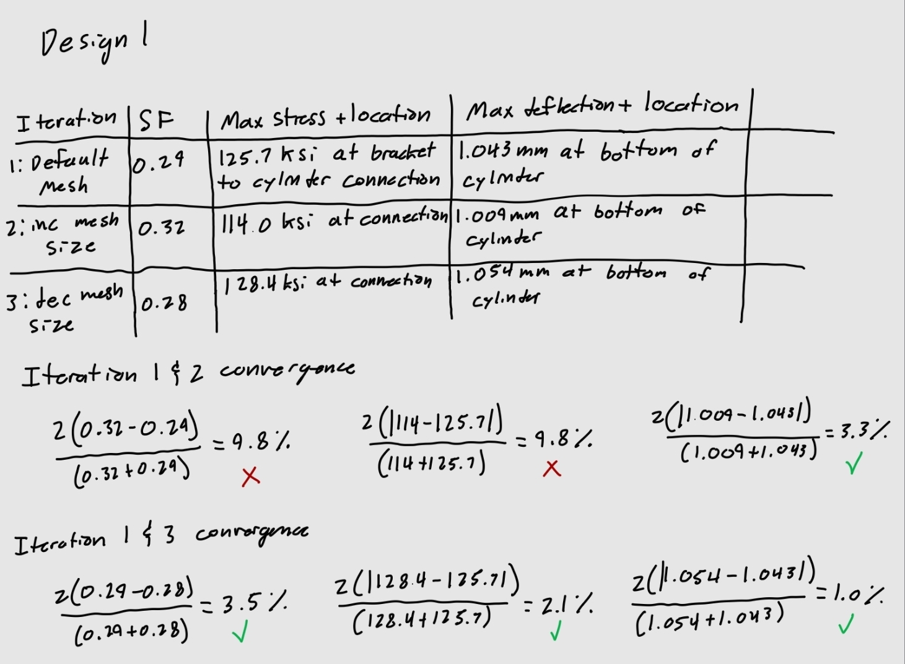  

This test showed me that although the deflection was within acceptable range. The high max stress and the very low safety factor it caused on the connection was cause for concern. 

This connection was where I focused the improvement of my design. For my first optimization, I increased the width of the sides of the sides of the bracket and added a triangular support between the connection and the bottom of the bracket base. In hindsight, the changing of the width of the sides of the bracket was not necessary and was due to a misreading of the safety factor plot.  

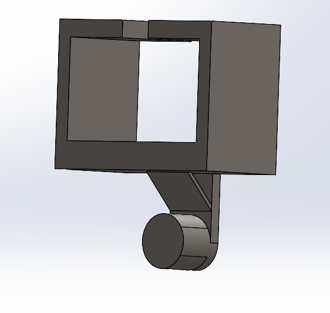  

It became apparent that this optimization was not sufficient when doing the FEA analysis and the safety factor decreased even more and the meshes would not converge.  

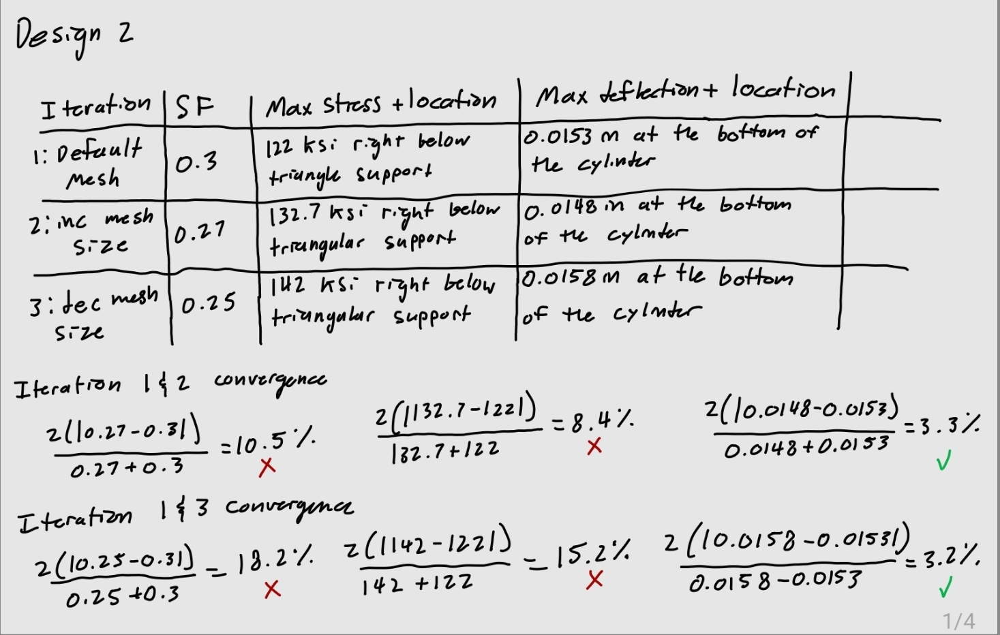  

For the third and final optimization, I increased the width of the connection to hopefully spread out the stresses acting on it on a larger surface area. I also added cuts in the sides to decrease the overall weight.  

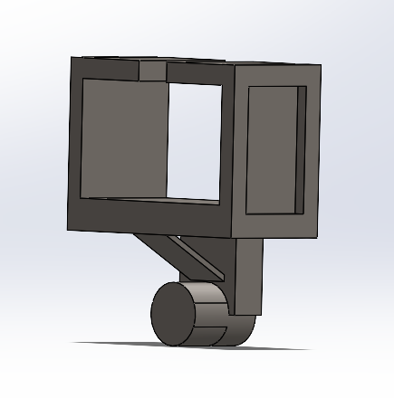  

This design yielded better results in all parameters, although the safety factor was still small, it was isolated to very small parts of the connection piece.  

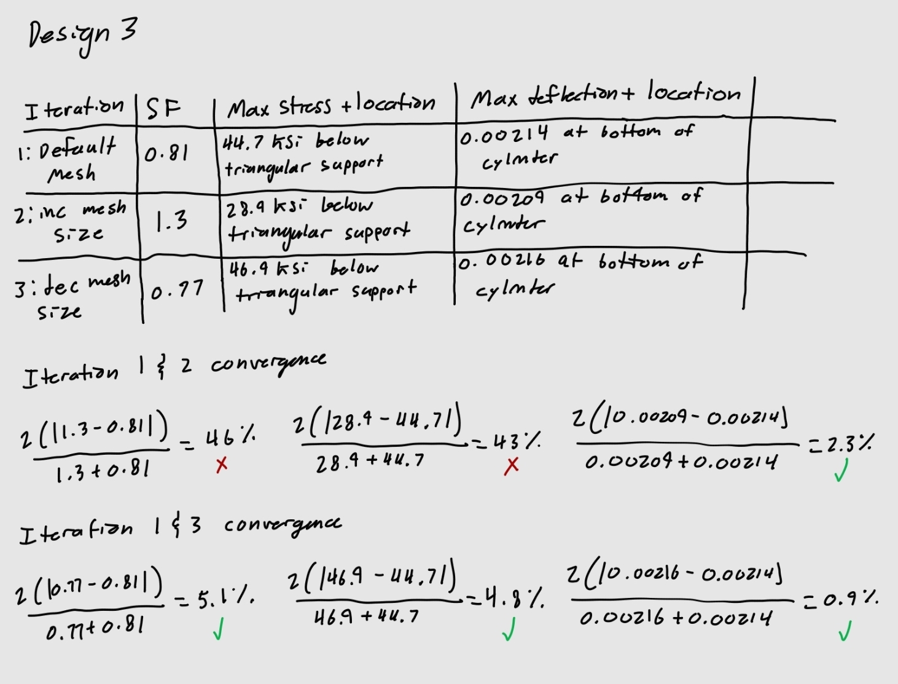  

I tabulated the results of all three designs, where it is obvious that the third optimization was the best.   

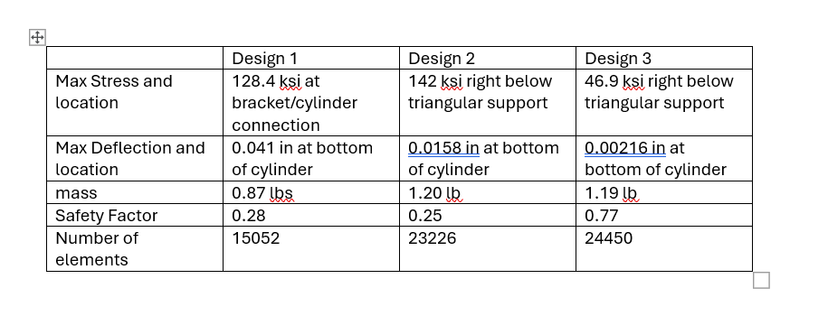  

**Link to File:** https://drive.google.com/file/d/1Lve3S8CwM9GcvglzAC4Yeh8BVqDJl1Is/view?usp=sharing  

## FEA on Linkage  

Just like the bracket, I began with the original linkage as my first design to be analyzed.  

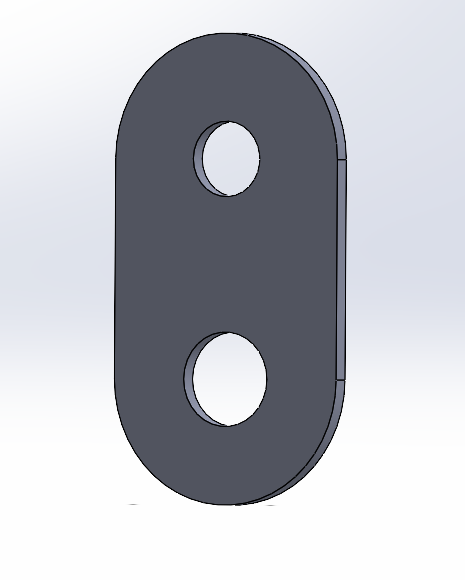  

For the linkage, I set the constraint to be the upper hole that connects to the bracket, and the force to be applied on the inside of the bottom hole that holds the bar loaded with the 1200 lbf.  

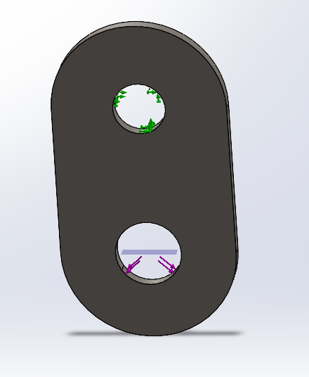  

## Decide

## Communicate

