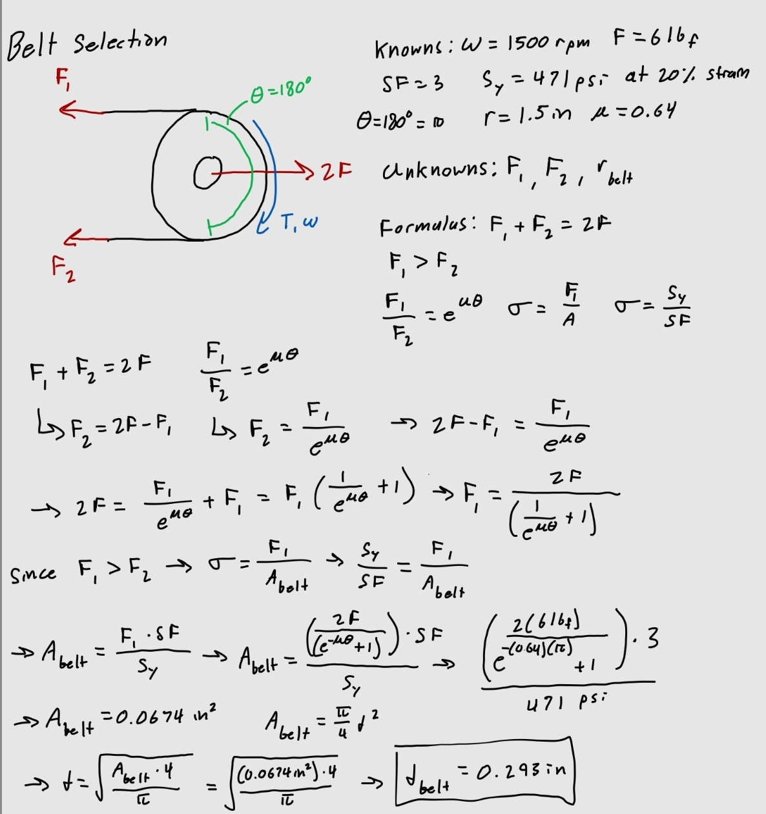
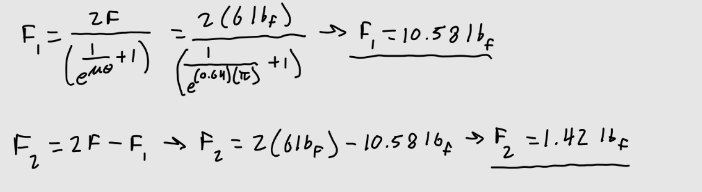
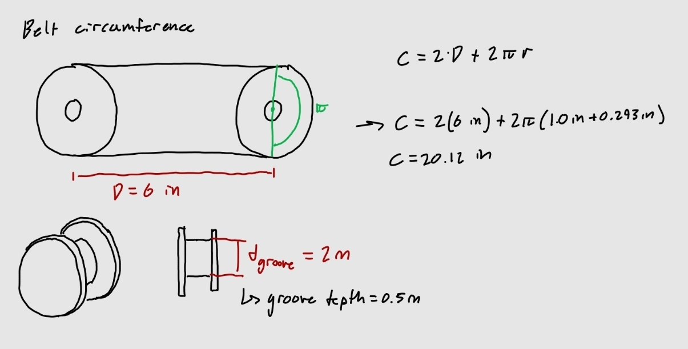
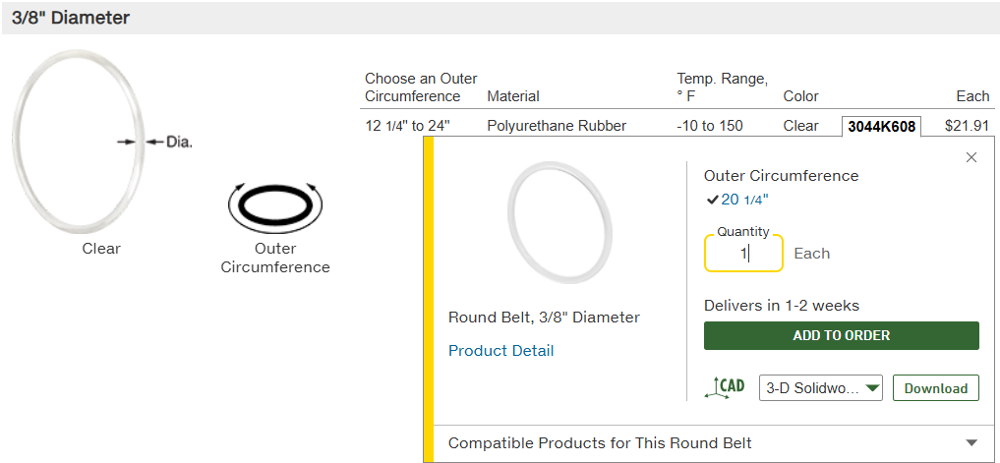
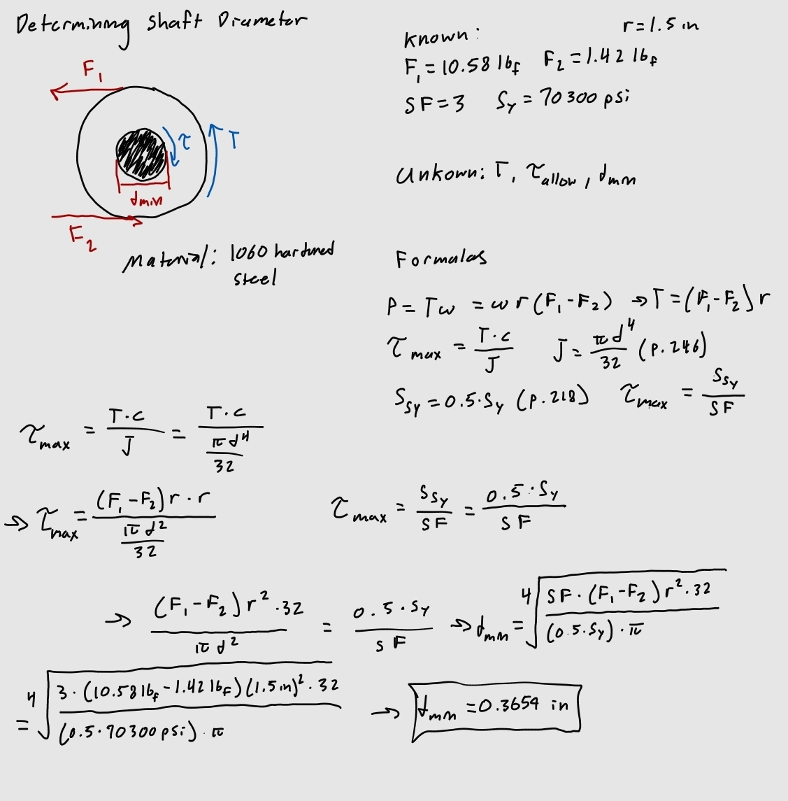
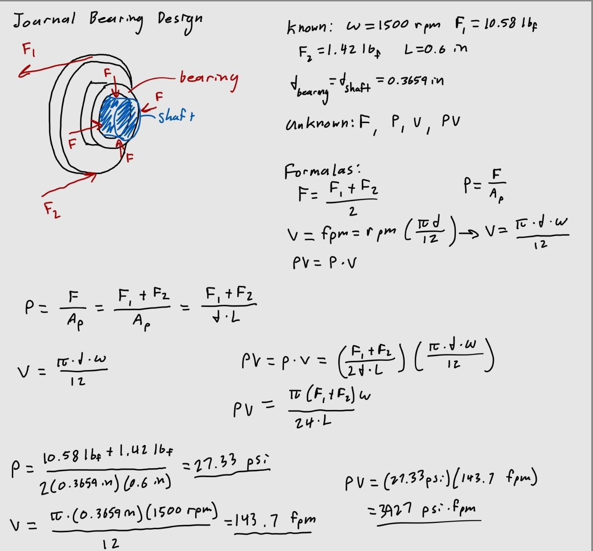
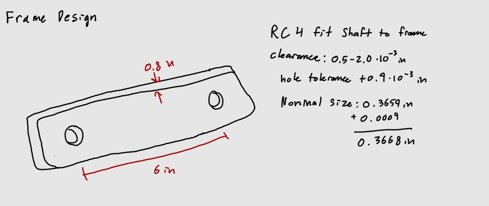
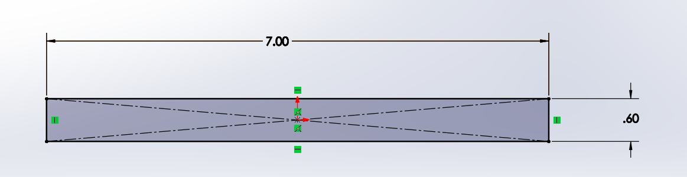
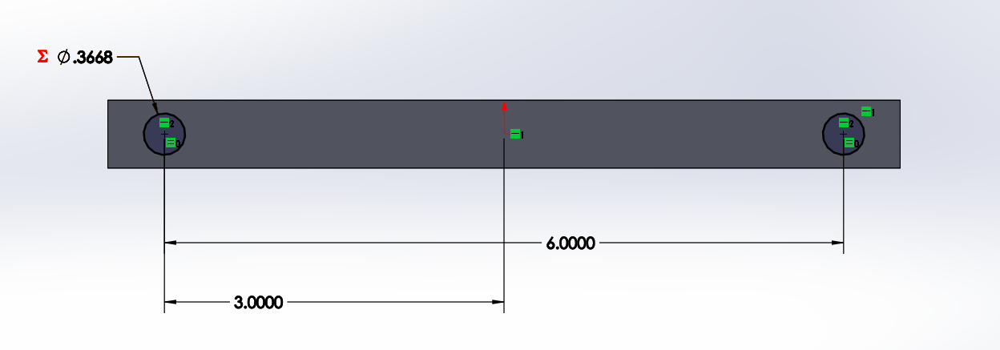
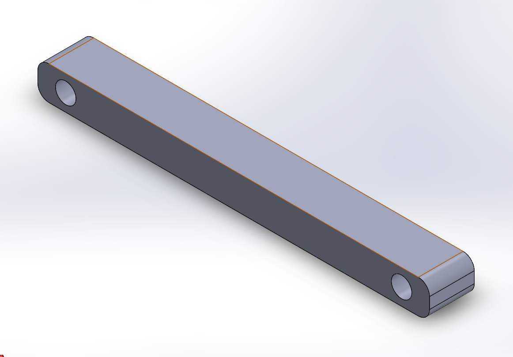

# A9 – Pulleys

## Belt Selection

For my pulley design, I chose a belt tension of 6 lbf, a rotational speed of 1500 rpm, and steel for the pulley wheels. The goal was to find a proper diameter for a round belt using the known information. This is determined by the force in the belt caused by the tension on the pulley while static, the friction and contact area between the belt and pulley, and the allowable stress in the belt determined by a safety factor of 3.  

I used a static analysis to make a connection between the forces and the friction on a curved surface. I then connected this to the formula for allowable stress to find the minimum diameter. I used F1 in the stress formula because it is guaranteed to be a larger magnitude by being the taught side of the pulley. I found an approximate coefficient of friction of 0.64 from (https://www.engineersedge.com/coeffients_of_friction.htm) that compares Rubber (60 A belt) and Stainless Steel 316. 

  

I then used the formulas to solve for F1 and F2.  

  

I then solved for the circumference of the belt based on the center distance between the wheels and the diameter of the wheels. I also decided on a groove diameter, I had a hard time finding a source with exact calculations for proper groove heights based on round belts, but from (https://www.engineersedge.com/v_belt_sheave.htm) I found that many of the belts had a minimum groove height of about 0.5 in, so I used that.  

  

I used the diameter an circumference to choose a belt from McMaster Carr.  

  

## Shaft Dimensions  

Next I needed to find a minimum diameter of the shaft inserted into the pulley. The process for this was to make connections between the torque caused by the force from the belt and the torsion equation for a solid circular shaft. I also used the polar moment of inertia equation for a solid circular cross section to make the connection to diameter. I also used a connection between yield strength and shear strength, along with the formula for shear stress related to safety factor and yield strength. I used the yield strength for 1060 Hardened Steel.  

  

## Journal Bearing Design  

To properly hold the pulley, the shaft must remain still while the pulley turns. To accomplish this a journal bearing is necessary between the shaft and the pulley wheel. To correctly choose a material that can withstand the radial load and speed of the pulley, I calculated the pressure, linear velocity, and PV capacity. I can use these values to choose a material from the Machinery's Handbook. 

The load on the bearing would be equal to the forces F1 and F2 acting on the wheel. Since I was just calculating to choose a material, I did not choose a fit for the bearing and shaft, so I just used the diameter of the shaft in the calculation.  

  

From the Machinery's Handbook, I found Reinforced Teflon to be the most suitable material.  

## Frame

Finally, I designed a frame for the pulley system. There were not many design considerations necessary for this part considering the forces were not large enough to need a thick part. However, I figured that most of the shaft should be in the supportive frame, to keep the pulley system stable. I also created an RC4 fit to the holes. This allows a close fit with minimum play and is efficient for moderate turning speeds and journal pressure, which fit this application.  

  
  
  
  

## Lessons Learned

I learned how multiple different factors contribute to an efficient pulley, especially how important friction is in transmitting force and avoiding slippage between the belt and wheel. Additionally, I learned the importance of considering the taught side and slack side of belt when calculating stresses.  

Resources: 

https://www.engineersedge.com/coeffients_of_friction.htm  
https://www.engineersedge.com/v_belt_sheave.htm  
https://www.azom.com/article.aspx?ArticleID=6542  
Reading: “Solid Mechanics- Dynamics: Tutorial - Pulley Drive Systems” - DJ Dunn  
https://www.mcmaster.com/products/round-belts/round-belts-2~~/system-of-measurement~inch/  
Machinery's Handbook  

