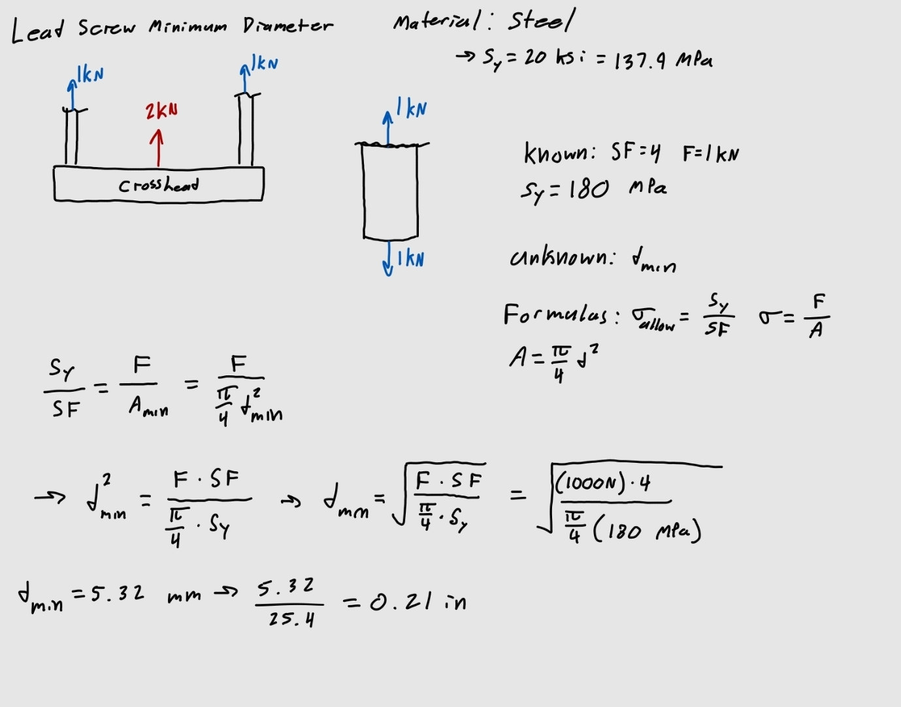
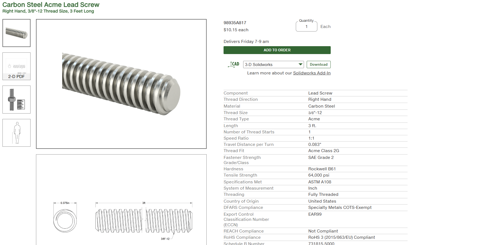
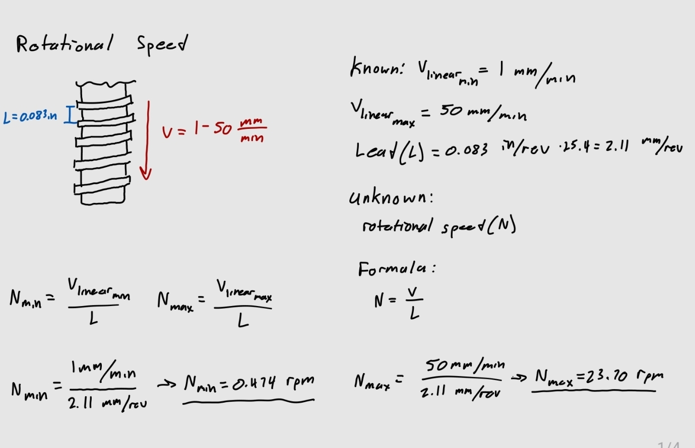
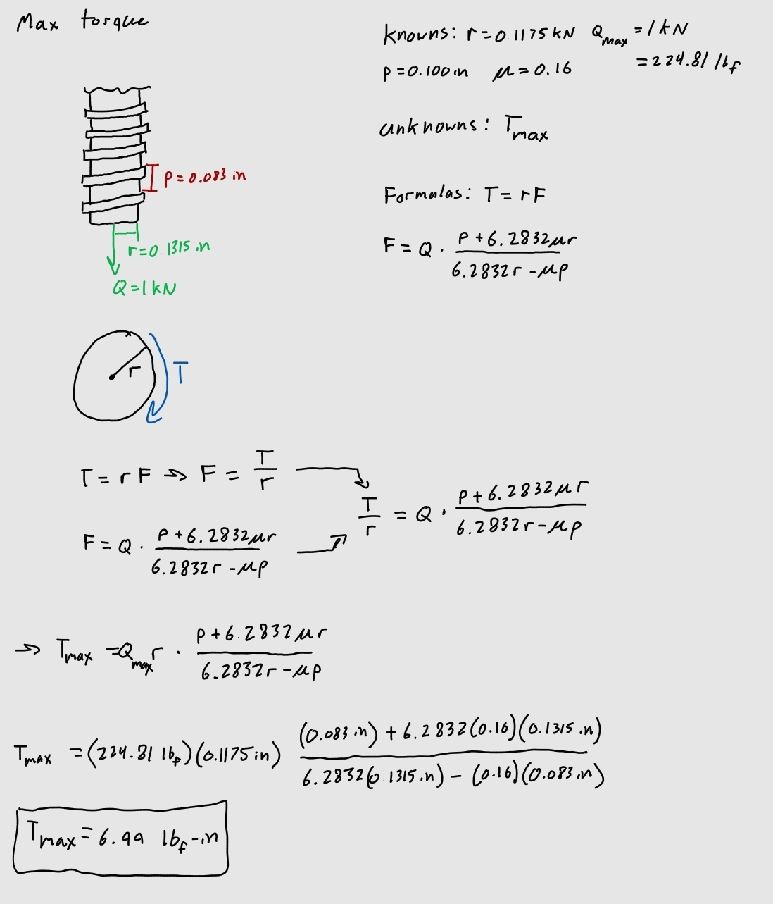
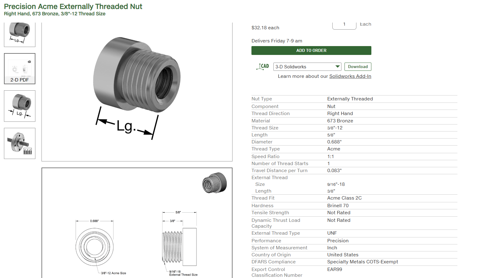
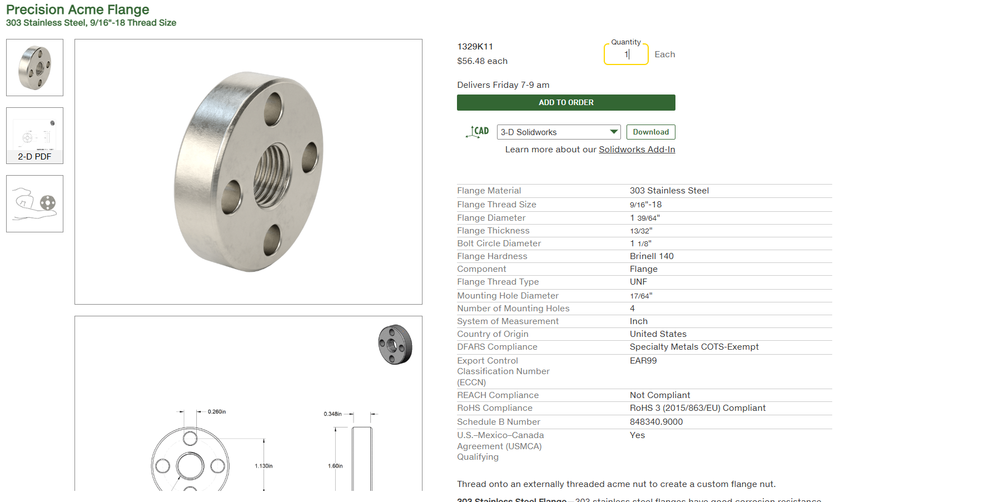
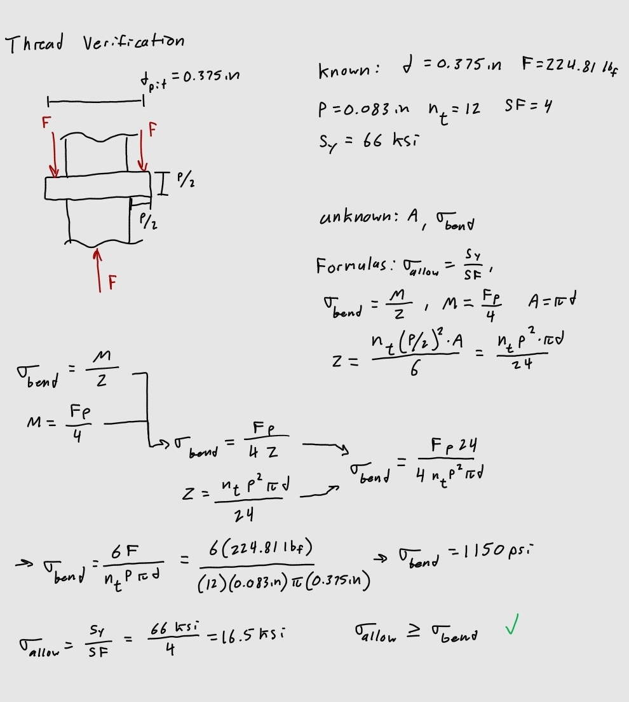

# A10 – Lead Screw Translating System

## Leadscrew Diameter, Speed, and Torque: Jack Welch  

To begin the selection of an appropriate lead screw, I solved for a minimum diameter that the screws needed to be to handle a maximum load. The load capacity of the tensile tester was to be 2kN, due to equilibrium each screw would be handling a load of 1 kN. From research I found that lead screws were mainly made from steel, so I used the yield strength for steel with a safety factor of 4 to determine an allowable stress.  

  

I found the minimum diameter to be 0.21 in, from there I chose a lead screw with a minor diameter larger than that, and that was also available in McMaster, which I found to be the 3/8 - 12 thread size. From there I could use the lead to solve for speed and torque.  

  

From there I found the range of rotational speeds from the linear speed by using the lead length of 0.083 in.  

  

Then I found the torque using the load, pitch radius of the lead screw, the lead, and the coefficient of friction between the steel lead screw and the 673 bronze nut.  

  

## Selecting a Nut and Flange: Jack Welch

From the lead screw I was able to choose a corresponding bronze nut and steel flange that all fit together.  

  
  

Before I could confirm the use of the nut and flange, I needed to verify that the internal threading would be able to handle the 1 kN load, I already figured this would not be an issue considering I chose the 12 thread nut and screw.  

  

## FEA Analysis

## Communicate

