# A11 – Motor Selection

## Motor Selection and Attachments: Jack Welch

### Motor Choice

I decided to look for stepper motors for our tensile tester design. The stepper motor was the best choice because it moves in discrete, controllable steps. This control is ideal for testing the tensile strength of a material in small discrete increments.  

I searched for motors by analyzing different NEMA motor's torque speed curves, the max torque required to manage the 2kN load I found when analyzing the lead screw in the last assignment was 6.99 lbf-in. All the torque speed curves were measure in Nm or oz-in, so I converted the torque to 112 oz-in. I found a NEMA 23 Standard Hybrid Stepper Motor to be the best choice, specifically the ML23HS4L4340 model. This motor had a capability to produce a torque of about 125-130 oz-in at its lowest rpm.  

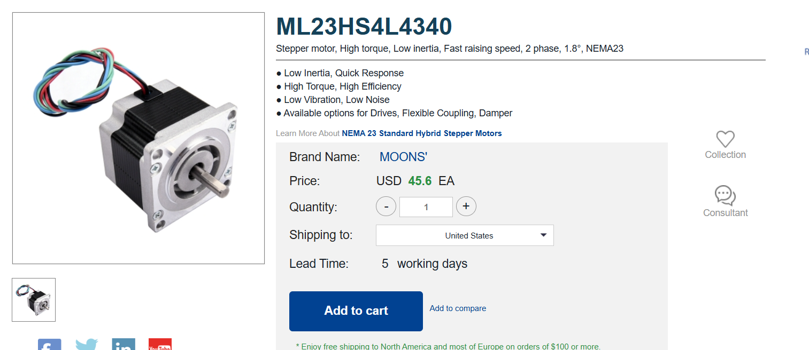  
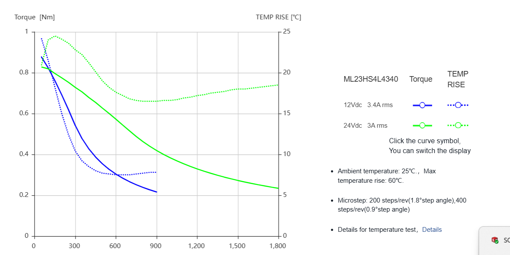  

This motor had a speed of about 50 rpm at it's recorded slowest, but this could be reduced by limiting the current to produce the lower rpm's the tensile tester required. It's rated current is 3.4 A and a 12 V voltage. It's mounting interface is four bolts in a square.  

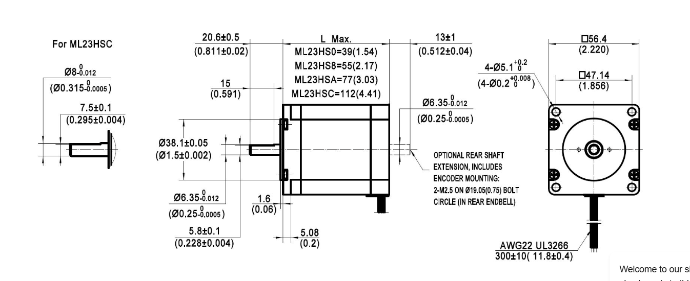  

This drawing is what I based my bracket and coupler design from.  

### Motor Bracket Design  

Before I did any calculations, I made a rough draft of my intended design. My idea was to have a rectangular plate that would have a hole for the coupler. I first made the hole to fit the shaft, but realized the coupler would need to fit there so I changed it. I also added a circular cutout around the hole to nest the outcrop around the shaft for stability. Then I added vertical columns to the corners that connected at the top to secure the motor from its top base. In my final design I added extra mass to the walls from the corners to increase the security. I left the cutout space on each side so that the motor could be easily assembled and disassembled. I added a clearance to the inner cavity sides so the motor can be slid in and out of. I also added a clearance for the coupler so that it could be assembled.  

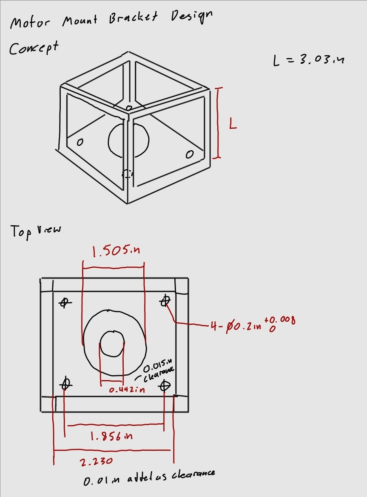  

Due to the torque of the motor transmitted into the frame, the base of the frame needed to have a minimum thickness to withstand the bearing stress that would be transmitted from the reactionary torque of the four screws. I chose for the bracket to be 1060 Aluminum and used the yield strength and the safety factor of 4 to find an allowable bearing stress.  

  

The only addition I made to the model was the increase in wall coverage. The height I used to for the bracket was outlined in the drawing, which I used for the height of the bracket.  

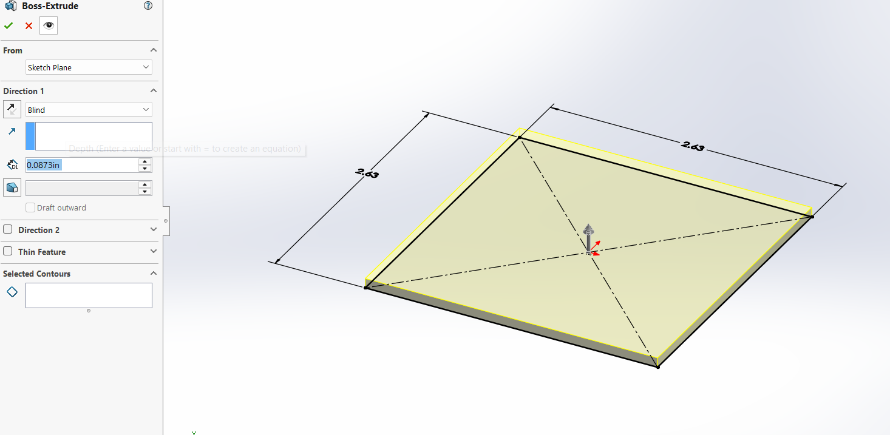  
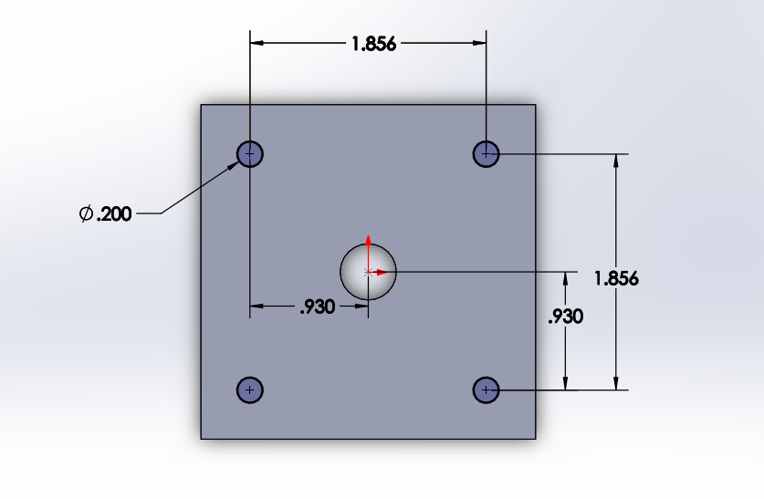  
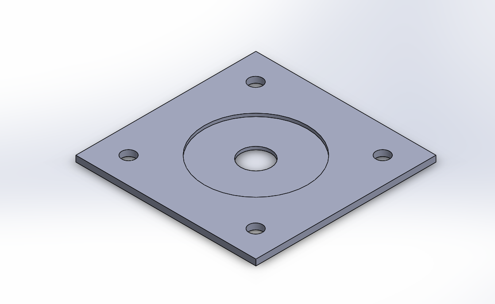  
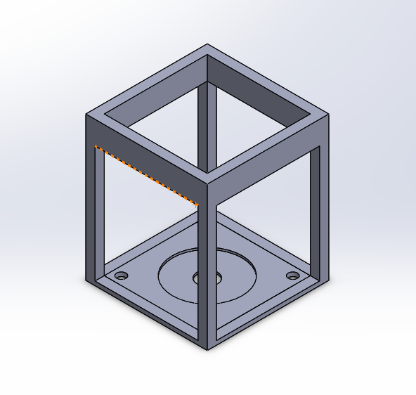  
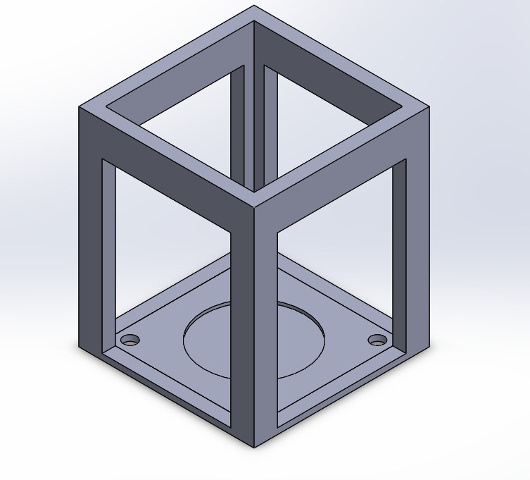  

### Coupler Design  

The purpose of the coupler is to interface and transmit torque between the motor shaft and lead screw. I knew the larger inner diameter to be the diameter of the lead screw. I then needed to use shear stress torsion analysis to find the outer diameter and thickness of the coupler. 1060 Aluminum was chosen for the coupler.  

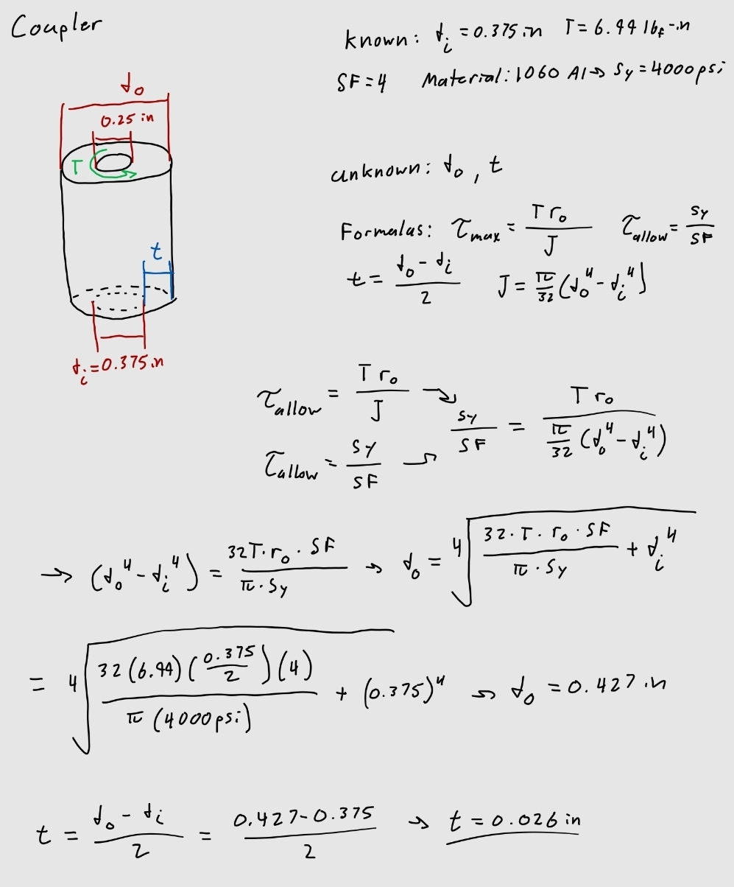  

I used this found thickness to model the coupler, I made it tall enough to to fit through the frame. The hole for the shaft is large enough to fit the entirety of the shaft, and I made the hole for the lead screw the same length for simplicity.  

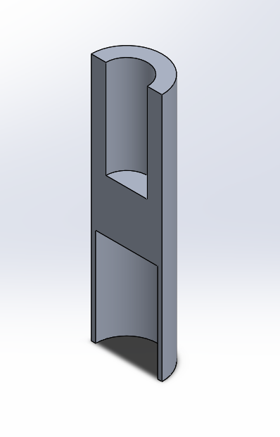   

## Frame Bracket Design: Saniyah Wilson

## Floating Bearing: Jack Welch 
For the floating bearing and its mount to the bottom frame, a RC3 fit was used for the bearing and I used a locational clearance fit for the bolts to the frame, which is common.  

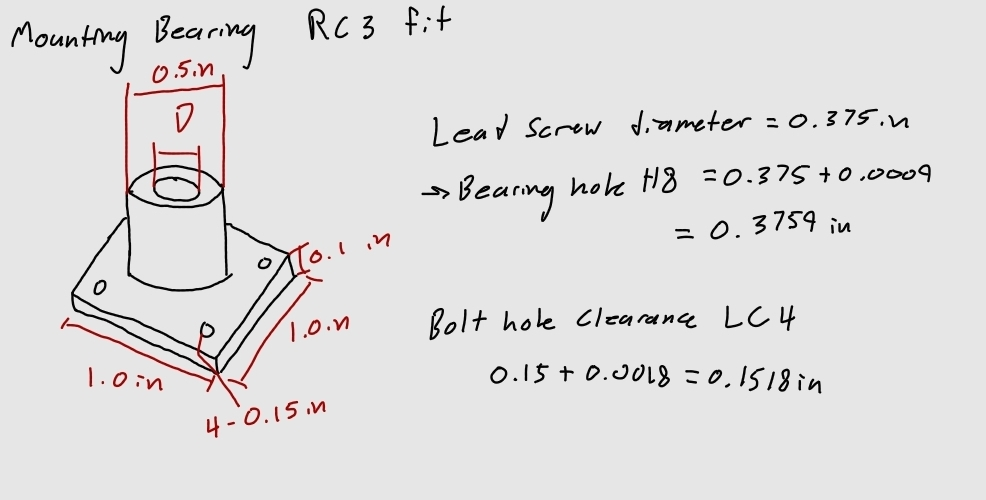  

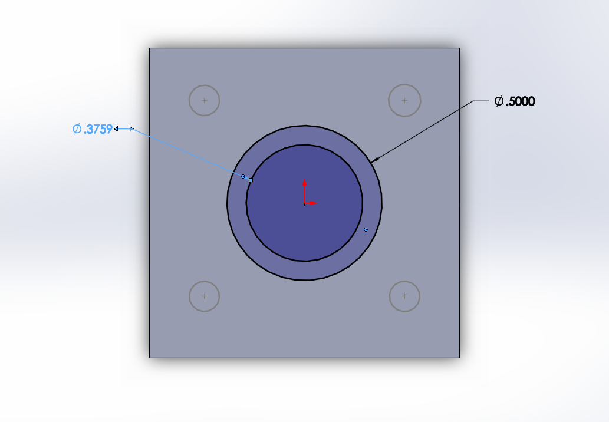  
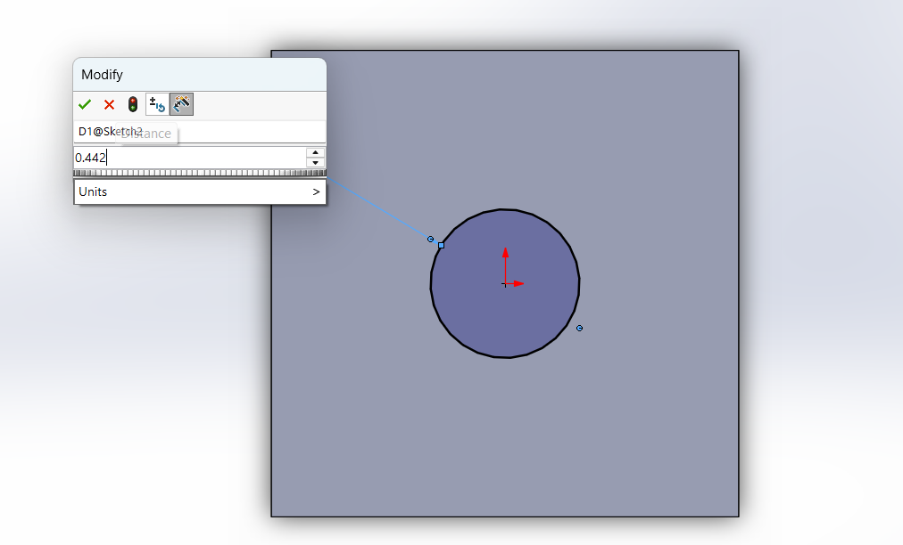  
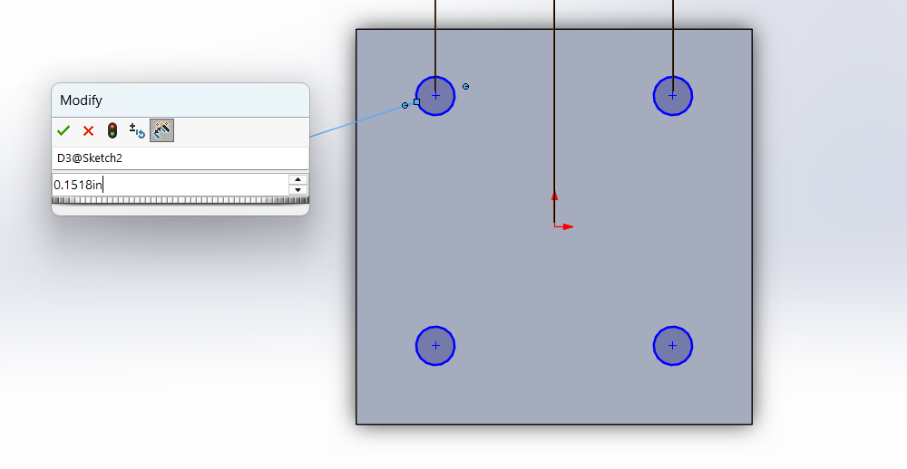  
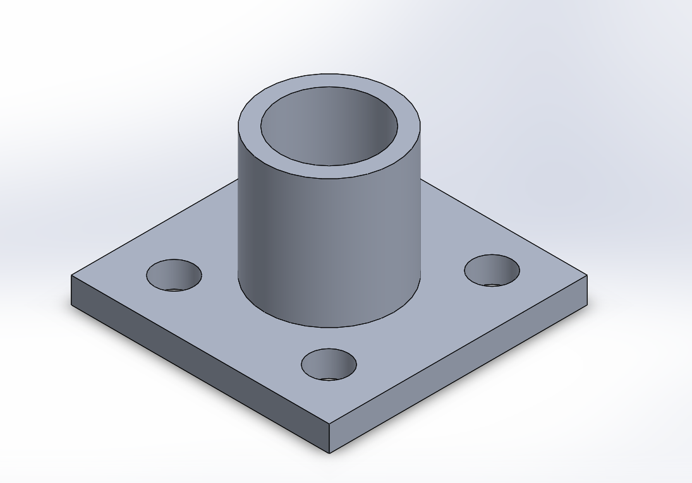   

## Lessons Learned: Jack Welch

I learned a lot about the relationship between current/voltage input and torque output for stepper motors. I also learned how torque transmits stress through a part and specifically to hole and pin connections. This lead me to discover the different necessary components to create a functional and stable tensile tester, including the coupler, floating bearing and motor frame. 

## Drawings: Saniyah Wilson
